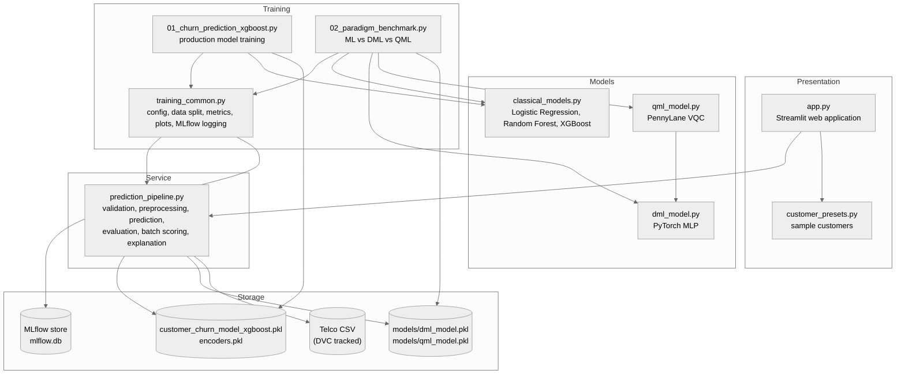
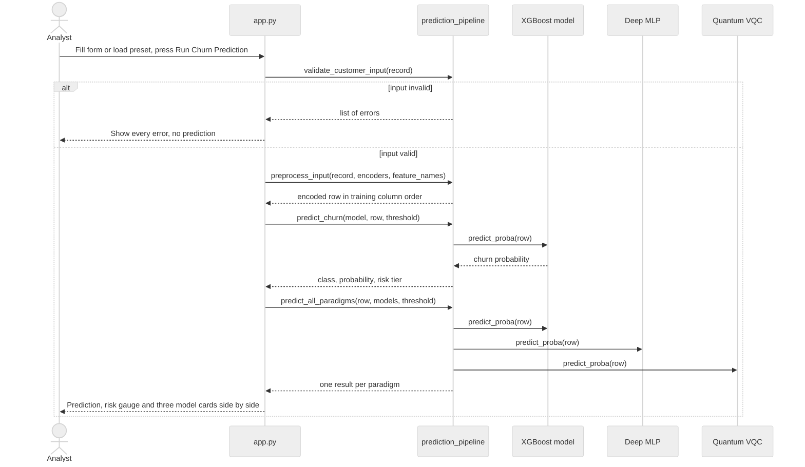
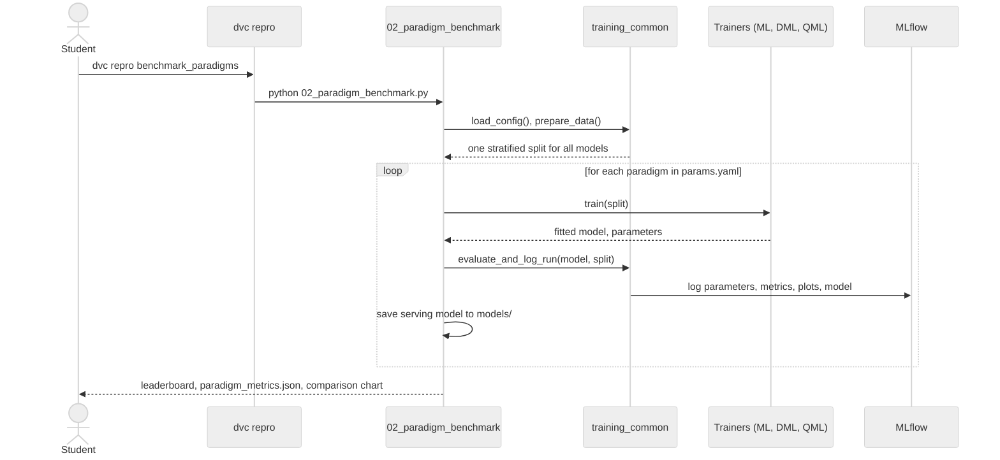
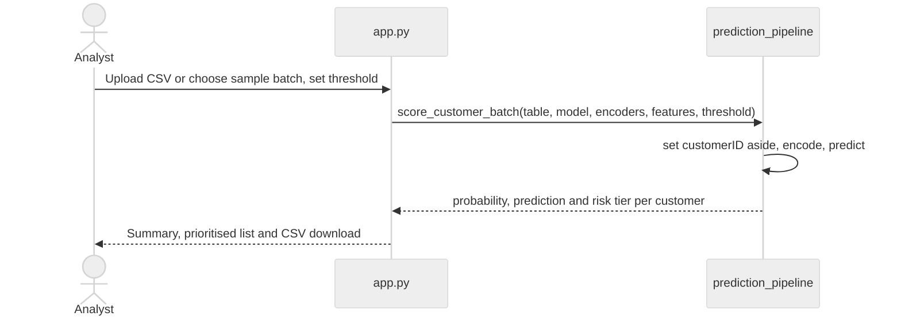
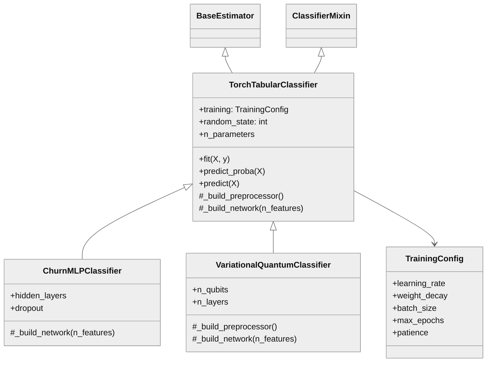

# Software Architecture and Design Specification, Version 1.1 (Addendum)

Project: Customer Churn Prediction Model
Team: Hackforge (Akshaya B, Ashwin C H, Amar Patil)
Course: Software Engineering Mini Project, PES University
Base document: SAD v1.0, Part B of `docs/deliverables/Hackforge_Customer_Churn_Deliverable1.docx`

## Revision History

| Version | Date | Description |
|---|---|---|
| 1.0 | 12 October 2026 | Architecture of the command line training pipeline (Deliverable 1). |
| 1.1 | 30 October 2026 | Adds the web application, the prediction service module, the deep learning and quantum models, the paradigm benchmark and the MLOps tooling (DVC, MLflow, CI). Adds the API design for the prediction module. |

## 1. Introduction

### 1.1 Purpose and scope

This addendum describes the architecture of the system as delivered at the end of Sprint 3. It follows the layout of IEEE 1016 and builds on SAD v1.0, whose pipeline design is unchanged and is now one part of a larger system. Section 3.9 of SAD v1.0 listed a prediction feature, a dashboard and model monitoring as future work; this version shows how the first two were built.

### 1.2 Design goals (additions)

1. Keep all business logic (validation, preprocessing, prediction, evaluation) in one module that the user interface, the tests and the training scripts all share.
2. Let the user interface show every paradigm without depending on how each model works inside.
3. Make every training result reproducible and traceable to its parameters.
4. Never overwrite the validated production model by accident.

## 2. Architectural Design

### 2.1 Architecture patterns

| Pattern | Where it is used | Why |
|---|---|---|
| Layered architecture | Presentation (`app.py`), service (`prediction_pipeline.py`), model and data layer (saved models, dataset) | The user interface never touches model internals, so models can change without changing the UI. |
| Pipeline (pipes and filters) | `01_churn_prediction_xgboost.py`, `02_paradigm_benchmark.py`, `dvc.yaml` | Each stage (load, prepare, train, evaluate, save) has one job and a clear input and output, as in v1.0. |
| Adapter | `TorchTabularClassifier` in `dml_model.py`, used by `qml_model.py` | The PyTorch and PennyLane models expose the scikit-learn `fit` / `predict_proba` interface, so the same evaluation, logging and serving code works for all three paradigms. |
| Template method | `TorchTabularClassifier._build_network`, overridden by `ChurnMLPClassifier` and `VariationalQuantumClassifier` | Training, early stopping and saving are written once; each paradigm only defines its network. |
| Registry / strategy | `TRAINERS` in `01_churn_prediction_xgboost.py`, `build_plan` in `02_paradigm_benchmark.py` | The model families to train are chosen from `params.yaml` without changing code. |
| Cache | `st.cache_resource` in `app.py` | Models are loaded once per session, which keeps a prediction under 200 ms (NFR-11). |

### 2.2 Component diagram

### 2.3 Components

| Component | Responsibility | Input / output |
|---|---|---|
| Web application (`app.py`) | Four pages: prediction with the three-paradigm comparison, batch scoring, model evaluation, and project information. | In: user input. Out: predictions, charts, downloadable CSV. |
| Customer presets (`customer_presets.py`) | Four realistic sample customers for one-click demonstration. | Out: customer records. |
| Prediction service (`prediction_pipeline.py`) | All business rules: input validation, encoding, prediction, risk tiers, evaluation, batch scoring, explanation, paradigm model loading. | In: customer records, model files. Out: predictions and metrics. |
| Classical models (`classical_models.py`) | Trainers for Logistic Regression, Random Forest and XGBoost with grid search. | In: data split, config. Out: trained model and parameters. |
| Deep learning model (`dml_model.py`) | MLP with one-hot and scaled inputs, batch normalisation, dropout, class-weighted loss and early stopping. | In: encoded features. Out: churn probabilities. |
| Quantum model (`qml_model.py`) | Variational quantum classifier: PCA to 6 features, angle embedding, 3 entangling layers, measurement and a linear output. | In: encoded features. Out: churn probabilities. |
| Training utilities (`training_common.py`) | Shared configuration, data split, metrics, plots and MLflow logging, so every model is measured the same way. | In: `params.yaml`, dataset. Out: metrics, plots, MLflow runs. |
| Production training (`01_churn_prediction_xgboost.py`) | Trains the classical models and exports the best one with its encoders. | Out: model, encoders, `metrics.json`. |
| Paradigm benchmark (`02_paradigm_benchmark.py`) | Trains ML, DML and QML on one split and writes the leaderboard and serving models. | Out: `paradigm_metrics.json`, `models/*.pkl`, comparison chart. |

### 2.4 Technology stack (additions)

| Technology | Used for |
|---|---|
| Streamlit and Altair | Web application and charts |
| PyTorch | Deep learning model |
| PennyLane | Quantum circuit simulation for the QML model |
| DVC | Reproducible pipeline (`dvc.yaml`, `params.yaml`, `dvc.lock`) and dataset versioning |
| MLflow | Experiment tracking (parameters, metrics, plots, models) |
| pytest, pytest-cov, Streamlit AppTest | Automated testing and coverage |
| pylint | Static analysis |
| GitHub Actions | Continuous integration |

### 2.5 Deployment view

The system runs on one laptop or desktop. The user starts the web application with `streamlit run app.py` (port 8501) and, if needed, the MLflow UI with `mlflow ui --port 5001`. Models, data and experiment records are local files. GitHub Actions runs the same tests on a clean Ubuntu machine for every pull request.

### 2.6 Requirements to design mapping (additions)

| Requirement IDs | Design component | How it is handled |
|---|---|---|
| FR-15, UI-02 | `app.py`, `customer_presets.py` | Form with 19 labelled fields in three groups, preset selector, four pages. |
| FR-16, SR-05, NFR-08 | `prediction_pipeline.validate_customer_input`, `preprocess_input` | One validation function checks every form submission and names each field in error; `preprocess_input` rejects unknown categories and missing columns for both single and batch input. |
| FR-17 | `preprocess_input`, `predict_churn`, `get_risk_tier` | Encodes in training column order, predicts, assigns the risk tier. |
| FR-18 | `evaluate_model_on_dataset`, `compare_with_benchmark` | Rebuilds the exact training test split and compares with the saved benchmark. |
| FR-19 | `score_customer_batch` | Vectorised scoring of a whole table. |
| FR-20 | `explain_customer_risk`, what-if section of `app.py` | Rule-based driver explanation and re-prediction with changed inputs. |
| FR-21, SR-07 | `load_paradigm_model`, `predict_all_paradigms`, `render_paradigm_comparison` | Loads and checks the DML and QML models, scores the customer with all three. |
| FR-22, FR-23 | `dml_model.py`, `qml_model.py` | Scikit-learn compatible estimators that can be pickled. |
| FR-24, NFR-12, SW-03, SR-06 | `02_paradigm_benchmark.py`, `training_common.py`, `dvc.yaml` | Same split for every model, local MLflow logging, DVC stage. |
| NFR-11 | `st.cache_resource` | Models are loaded once per session. |
| NFR-13 | `pyproject.toml`, `.github/workflows/ci.yml` | pylint threshold and coverage threshold enforced in CI. |

### 2.7 Security architecture (additions)

| Risk | Design response | Requirements |
|---|---|---|
| A tampered or wrong model file is loaded by the application | Paradigm models are loaded only from `models/`; the payload must be a model dictionary whose input features match the production model, otherwise it is rejected with a clear message. | SR-07 |
| Experiment data leaves the machine | MLflow uses a local SQLite store; no remote tracking server or API key is configured. | SR-06, SR-04 |
| Uploaded batch CSV contains bad or unexpected values | The table goes through the same encoding checks as the form, so unknown categories or missing columns stop the batch with a clear message. `customerID` is kept only as a label and is never a model input. | SR-05, SR-01 |
| The production model is overwritten during testing | Tests run the training pipeline with every output redirected to a temporary folder. | SO-02 |

## 3. Detailed Design

### 3.1 Sequence diagram: predict one customer with all three paradigms

### 3.2 Sequence diagram: paradigm benchmark

### 3.3 Sequence diagram: batch scoring

### 3.4 Class design of the model layer

### 3.5 Model design summary

| Paradigm | Model | Input processing | Structure | Training |
|---|---|---|---|---|
| ML | XGBoost | Label-encoded features | Gradient boosted trees, grid-searched depth, learning rate and number of trees | `scale_pos_weight` 2.77, 3-fold stratified CV |
| DML | Multi-layer perceptron | One-hot categories and standardised numbers (45 inputs) | 64 and 32 units, each Linear, BatchNorm, ReLU, Dropout 0.3 | Adam, class-weighted cross-entropy, early stopping on a validation slice |
| QML | Variational quantum classifier | One-hot and scaled, PCA to 6 features, scaled to angles in [0, pi] | 6 qubits, angle embedding re-uploaded before each of 3 entangling layers, Pauli-Z measurement, linear output | Same optimiser and loss as DML, simulated with PennyLane |

### 3.6 API design

The system has no network API by design (COM-01). Its programming interface is the `prediction_pipeline` module, which the web application, the training scripts and the tests all use. The main functions are:

| Function | Inputs | Output | Errors |
|---|---|---|---|
| `load_artifacts(model_path, encoder_path)` | Paths (defaults to the production files) | `(model, feature_names, encoders)` | `FileNotFoundError` if a file is missing, `ValueError` if a file is invalid |
| `validate_customer_input(record)` | Dictionary with the 19 fields | `(is_valid, list_of_errors)` | None; problems are returned as messages |
| `preprocess_input(record_or_table, encoders, feature_names)` | Customer record or table | Encoded table in training column order | `ValueError` for unknown categories or missing columns |
| `predict_churn(model, row, threshold=0.5)` | Encoded row, threshold | `(class, churn_probability, probabilities, risk_tier)` | None |
| `get_risk_tier(probability)` | Churn probability | `"Low"`, `"Moderate"` or `"High"` | None |
| `evaluate_model_on_dataset(threshold=0.5, ...)` | Optional paths and threshold | Metrics, confusion matrix and report on the held-out test set | `FileNotFoundError`, `ValueError` |
| `compare_with_benchmark(results, benchmark=None)` | Live results | `(all_match, comparison_table)` | None |
| `score_customer_batch(table, model, encoders, feature_names, threshold)` | Table of customers | Table with probability, prediction and risk tier per row | `ValueError` for invalid tables |
| `explain_customer_risk(record, churn_probability)` | Customer record | Risk-raising and risk-lowering factors | None |
| `load_paradigm_model(path, feature_names)` | Path to a DML or QML model | Model payload with its test metrics | `FileNotFoundError`, `ImportError`, `ValueError` |
| `predict_all_paradigms(row, models, threshold=0.5)` | Encoded row, models by paradigm | One result per paradigm | None |

Command line interface:

| Command | Purpose |
|---|---|
| `streamlit run app.py` | Start the web application |
| `python 01_churn_prediction_xgboost.py` or `dvc repro train` | Train the classical models |
| `python 02_paradigm_benchmark.py` or `dvc repro benchmark_paradigms` | Run the ML vs DML vs QML benchmark |
| `pytest` | Run the automated tests |
| `python tools/generate_test_reports.py` | Run the tests and write the test reports |

### 3.7 Error handling (additions)

| Situation | What happens |
|---|---|
| A form field is empty, out of range or inconsistent | Every problem is listed under the form; no prediction is shown. |
| An uploaded CSV is missing columns or has unknown values | An error message names the problem and the batch is not scored. |
| PyTorch or PennyLane is not installed | The classical prediction is shown as normal; the DML and QML cards explain which package to install. |
| A paradigm model file is missing or does not match the production features | That card shows the reason; the other predictions are unaffected. |
| `params.yaml` is missing or cannot be read | The documented default settings are used and a warning is printed. |
| An unknown model type or paradigm is configured | The script stops with a message listing the valid options. |

### 3.8 Limitations and future work

1. The quantum model runs on a simulator; running it on quantum hardware is future work.
2. Model monitoring and scheduled retraining remain future work, as in v1.0.
3. Results come from one public dataset and should be re-validated on other customer data before business use.
