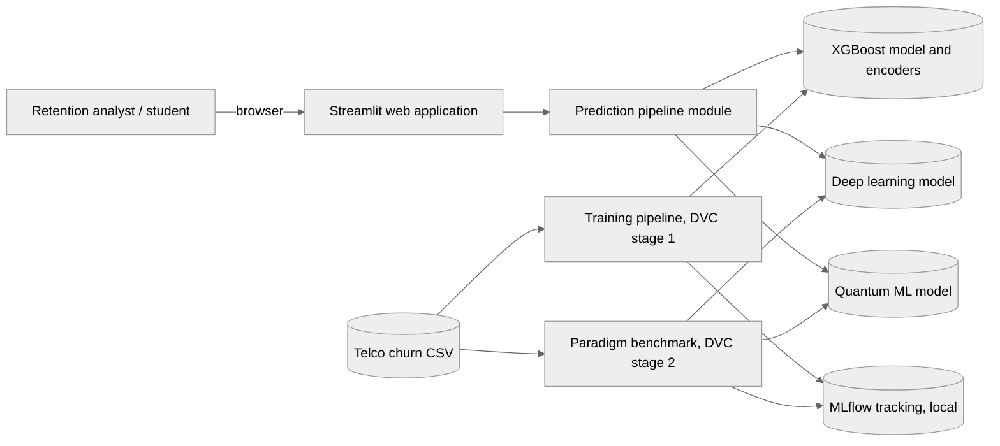
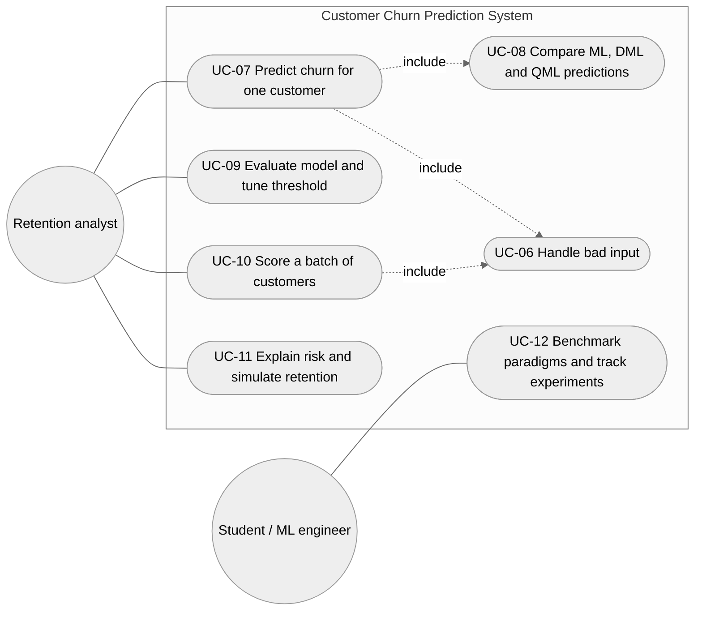

# Software Requirements Specification, Version 1.1 (Addendum)

Project: Customer Churn Prediction Model
Team: Hackforge (Akshaya B, Ashwin C H, Amar Patil)
Course: Software Engineering Mini Project, PES University
Base document: SRS v1.0, Part A of `docs/deliverables/Hackforge_Customer_Churn_Deliverable1.docx`

## Revision History

| Version | Date | Description |
|---|---|---|
| 1.0 | 12 October 2026 | Initial SRS for the command line training pipeline (Deliverable 1). |
| 1.1 | 30 October 2026 | Adds the requirements for the features built in Sprints 1 to 3: the Streamlit web application, batch scoring, the what-if simulator, and the comparison of classical, deep and quantum machine learning. Makes NFR-01 and NFR-08 measurable. Adds NFR-11 to NFR-13 and SR-06 to SR-07. |

## 1. Introduction

### 1.1 Purpose of this revision

SRS v1.0 described the first release of the project: a Python script that trains and evaluates an XGBoost churn model. During the sprints the team extended the product into a complete decision support application, as planned in Section 3.9 of the SAD ("a prediction feature ... could be added later", "a dashboard could be added as a separate feature in a future version"). This addendum records the requirements for those additions so that the SRS, the design and the tests describe the delivered system.

All requirements in SRS v1.0 remain valid and are still verified (Test Plan v1.1, TC-01 to TC-13). This document only lists what is new or revised.

### 1.2 Scope of version 1.1

The system now consists of:

1. The training pipeline (unchanged in purpose, now configured by `params.yaml` and run as a DVC pipeline stage).
2. A Streamlit web application for single-customer prediction, model evaluation, batch scoring and retention simulation.
3. A three-paradigm benchmark that trains a classical model (XGBoost), a deep learning model (multi-layer perceptron) and a quantum machine learning model (variational quantum classifier) on the same data split and tracks the experiments in MLflow.

The system still runs entirely on a local machine and does not connect to any live telecom or CRM system.

### 1.3 Additional definitions

| Term | Meaning |
|---|---|
| ML | Classical machine learning. In this project: XGBoost and Logistic Regression. |
| DML | Deep machine learning. In this project: a PyTorch multi-layer perceptron (MLP). |
| QML | Quantum machine learning. In this project: a variational quantum classifier (VQC) simulated with PennyLane. |
| Paradigm | One of the three approaches above. |
| Risk tier | Low (churn probability below 35%), Moderate (35% to 65%) or High (above 65%). |
| Decision threshold | Probability at or above which a customer is classified as Churn (default 0.50). |
| DVC | Data Version Control, used to define the reproducible training pipeline. |
| MLflow | Experiment tracking tool that records parameters, metrics and models for each training run. |

### 1.4 References

1. IEEE Std 830-1998, Recommended Practice for Software Requirements Specifications.
2. SRS v1.0, SAD v1.0 and Test Plan v1.0 (Deliverable 1).
3. SAD v1.1 Addendum (`docs/SAD_v1.1_Addendum.md`).
4. Test Plan v1.1 (`docs/TEST_PLAN_v1.1.md`).
5. Telco Customer Churn dataset (IBM sample data, `WA_Fn-UseC_-Telco-Customer-Churn.csv`).

## 2. Overall Description (changes)

### 2.1 Product perspective

The product is now a locally hosted web application backed by a reusable prediction module (`prediction_pipeline.py`). The original training script is kept and is one stage of a DVC pipeline. A second stage benchmarks the three paradigms.



### 2.2 Product functions (additions)

1. Enter or load a customer profile and get a churn prediction with probability and risk tier.
2. See the predictions of the classical, deep learning and quantum models for the same customer, side by side.
3. Evaluate the production model on the held-out test set and adjust the decision threshold.
4. Score a file of customers at once and download the results.
5. See which factors drive a customer's risk and simulate retention actions.
6. Train and compare the three paradigms, with every run recorded in MLflow.

### 2.3 User characteristics

In addition to the students and reviewers listed in v1.0, the web application is designed for a retention analyst with no programming knowledge. Every input has a label and help text, and results are explained in plain language.

### 2.4 Constraints (additions)

1. The web application runs locally with `streamlit run app.py` (port 8501). MLflow runs locally on port 5001, because port 5000 is used by macOS AirPlay.
2. The deep learning and quantum models need PyTorch and PennyLane (`requirements-research.txt`). If they are not installed the application still works and shows the classical prediction, with a short note for the other two.
3. The quantum model runs on a classical state-vector simulator, not on quantum hardware.

## 3. Specific Requirements (new and revised)

### 3.1 External interface requirements

| ID | Requirement | Priority | Verified by |
|---|---|---|---|
| UI-02 | The system shall provide a browser interface at `http://localhost:8501` with four pages: Customer Churn Prediction, Batch Customer Scoring, Model Evaluation and About the Project. | Must | TC-14 |
| SW-03 | Training and benchmark runs shall be recorded in a local MLflow tracking store, viewable with the MLflow UI on port 5001. | Should | TC-23 |

### 3.2 Use case view (additions)



| Use case | Description | Related requirements |
|---|---|---|
| UC-07: Predict churn for one customer | Fill in or load a profile and receive class, probability and risk tier. | FR-15, FR-16, FR-17 |
| UC-08: Compare paradigms | See the ML, DML and QML predictions for the same customer side by side. | FR-21 |
| UC-09: Evaluate model and tune threshold | Re-score the held-out test set and change the decision threshold. | FR-18 |
| UC-10: Score a batch | Upload a CSV or use the sample batch and download the scored list. | FR-19 |
| UC-11: Explain and simulate | See risk drivers and test retention actions such as a contract upgrade. | FR-20 |
| UC-12: Benchmark paradigms | Train the three paradigms on one split and compare them in MLflow. | FR-22, FR-23, FR-24 |

### 3.3 Functional requirements (new)

| ID | Requirement | Priority | Verified by |
|---|---|---|---|
| FR-15 | The system shall provide a customer profile form with all 19 model inputs, grouped into Demographics, Services and Contract and Billing, each with a label and help text, and at least four one-click sample presets. | Must | TC-14 |
| FR-16 | Before predicting, the system shall check required fields, allowed category values, numeric ranges (tenure 0 to 120 months, monthly charges 0 to 500, total charges 0 to 50,000) and service consistency rules. If any check fails it shall list every error and shall not show a prediction. | Must | TC-15 |
| FR-17 | For a valid profile the system shall show the predicted class, the churn probability as a percentage, and the risk tier. | Must | TC-16 |
| FR-18 | On request the system shall re-evaluate the production model on the 1,409-customer held-out test set and show accuracy, precision, recall, F1, specificity, ROC-AUC and the confusion matrix, at a decision threshold the user selects between 0.05 and 0.95. | Must | TC-17 |
| FR-19 | The system shall score a batch of customers (uploaded CSV or the 100-customer sample) in one action, giving each customer's churn probability, predicted class and risk tier, and offer the result as a CSV download. | Should | TC-18 |
| FR-20 | The system shall show the main factors raising or lowering a customer's churn risk, and shall let the user simulate retention actions and see the new churn probability. | Should | TC-19 |
| FR-21 | For every valid profile the system shall show the churn probability, predicted class and risk tier from the classical (XGBoost), deep learning (MLP) and quantum (VQC) models side by side, using the same decision threshold. | Must | TC-20 |
| FR-22 | The system shall provide a deep learning churn model (multi-layer perceptron) trained with class weighting and early stopping that can be saved and reloaded with identical predictions. | Must | TC-21 |
| FR-23 | The system shall provide a quantum machine learning churn model (variational quantum classifier, 6 qubits, 3 layers, simulated) that can be saved and reloaded with identical predictions. | Must | TC-22 |
| FR-24 | The system shall train ML, DML and QML models on the same stratified split, log each run's parameters, metrics, trainable parameter count and training time to MLflow, and write a leaderboard (`paradigm_metrics.json`) and a comparison chart. | Must | TC-23 |

### 3.4 Non-functional requirements (revised and new)

| ID | Category | Requirement | Verified by |
|---|---|---|---|
| NFR-01 (revised) | Performance | A full training run with the `params.yaml` grid (Logistic Regression, Random Forest and XGBoost) shall finish in under 300 seconds on a 4-core laptop CPU without a GPU. | TC-10 |
| NFR-08 (revised) | Usability | Every input field shall have a label and help text, and every validation message shall name the field it refers to. | TC-12, TC-15 |
| NFR-11 | Performance | The median time to validate, preprocess and predict one customer shall be under 200 ms on a laptop CPU. | TC-24 |
| NFR-12 | Reproducibility | Training and benchmarking shall be defined as DVC pipeline stages with all settings in `params.yaml`, and every run shall be recorded in MLflow with its parameters and metrics. | TC-23 |
| NFR-13 | Maintainability | The code shall score at least 8.5/10 in pylint, and the automated tests shall reach at least 85% combined statement and branch coverage of the application modules. Both shall be checked in continuous integration. | TC-26 |

### 3.5 Performance results (updated)

The production XGBoost model scores the following on the 1,409-customer held-out test set:

| Accuracy | Precision (churn) | Recall (churn) | F1 (churn) | ROC-AUC |
|---|---|---|---|---|
| 75.66% | 52.92% | 75.13% | 0.621 | 0.841 |

The three-paradigm benchmark on the same split:

| Paradigm | Model | Recall (churn) | ROC-AUC | Trainable parameters |
|---|---|---|---|---|
| ML | XGBoost | 79.41% | 0.846 | 5,628 tree nodes |
| DML | Deep MLP | 79.68% | 0.841 | 5,249 |
| ML | Logistic Regression | 79.41% | 0.839 | 20 |
| QML | Quantum VQC | 75.40% | 0.829 | 61 |

The quantum model comes within 0.02 ROC-AUC of XGBoost while using 61 trainable parameters, about one hundredth of the deep model.

### 3.6 Security requirements (new)

| ID | Objective | Requirement | Verified by |
|---|---|---|---|
| SR-06 | Confidentiality | Experiment tracking data (MLflow database and artifacts) shall be stored on the local machine only. | TC-23 |
| SR-07 | Integrity | The application shall load the deep and quantum models only from the project's `models/` folder, and shall reject a model file whose format or input features differ from the production model. | TC-20 |

## 4. Supporting Information (changes)

### 4.1 How to run

```bash
pip install -r requirements-research.txt     # application, MLOps tools, PyTorch and PennyLane
streamlit run app.py                          # web application on http://localhost:8501
dvc repro benchmark_paradigms                 # train and compare ML, DML and QML
mlflow ui --backend-store-uri sqlite:///mlflow.db --port 5001   # view the experiments
```

### 4.2 Requirement summary

| Group | v1.0 | Added in v1.1 | Total |
|---|---|---|---|
| Interface (UI, SW, HW, COM) | 5 | 2 | 7 |
| Functional (FR) | 14 | 10 | 24 |
| Non-functional (NFR) | 10 | 3 (and 2 revised) | 13 |
| Security objectives (SO) | 3 | 0 | 3 |
| Security requirements (SR) | 5 | 2 | 7 |

Every requirement is linked to a test case in Test Plan v1.1, and every test case has passed (see `docs/test-reports/SYSTEM_VALIDATION_REPORT.md`).
